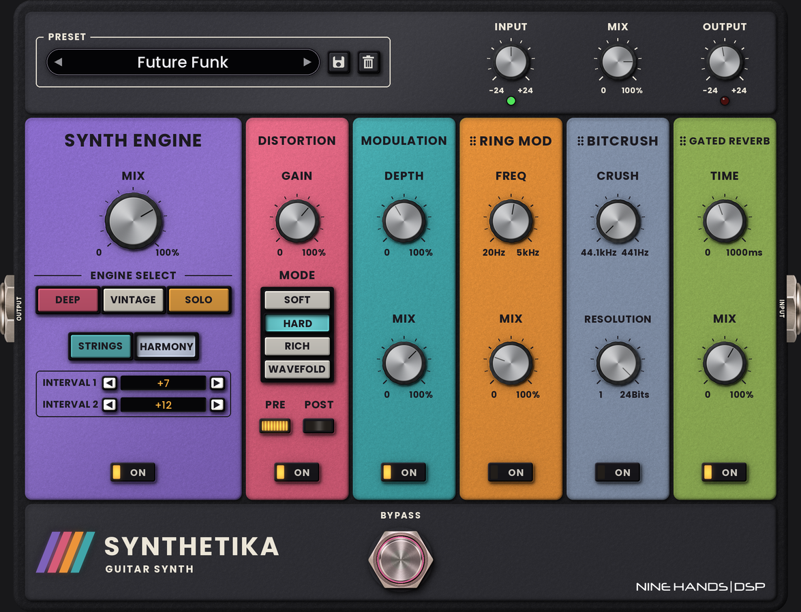

# Synthetika (NINE HANDS | DSP) — VST3

Synthé guitare monophonique au format pédale double, dans l'esprit du **Soklo GS-5** (Audio Hertz) : cinq moteurs
(Deep, Vintage, Solo, Strings, Harmony) qui suivent la guitare sans MIDI, puis Distortion, Modulation, Ring Mod, Bitcrush
et Gated Reverb. Disposition de la façade reprise du GS-5, couleurs et pièces NINE HANDS | DSP. Usage personnel.
Windows 11 et macOS (binaire universel).

  
  
   
  
   
  

## Installation

1. Les boutons ci-dessus téléchargent toujours la dernière version (Release publiée à chaque build de `main`).
2. **Windows** : copier `Synthetika.vst3` dans `C:\Program Files\Common Files\VST3\`.
   **macOS** : dézipper puis copier `Synthetika.vst3` dans `~/Library/Audio/Plug-Ins/VST3/`
   (si macOS le bloque : `xattr -cr ~/Library/Audio/Plug-Ins/VST3/Synthetika.vst3`).
3. Relancer l'analyse des plugins : le plugin apparaît comme **Synthetika (NINE HANDS | DSP)**.
   Le placer sur la piste guitare, avant Ampire et Impulse.

## Chaîne du signal

`Input` → chemin sec ─────────────────────────────────────────────────┐
`Input` → **Synth Engine** (+ Modulation) → Distortion **PRE** → Bitcrush / Ring Mod / Gated Reverb (ordre réglable) → Distortion **POST** → `Mix` → `Output`

| Module | Ce que fait Synthetika (`SynthDSP.h`) |
|---|---|
| Suivi de hauteur | YIN monophonique (signal décimé ~12 kHz), fenêtre de 256 + décalage jusqu'à 40 Hz (7 cordes en G et plus bas), affinage à pleine résolution ; glissement continu : bends, slides et vibrato passent au synthé |
| DEEP | Carré à 48 % + sinus de renfort, passe-bas doux, attaque ~70 ms — calé sur l'extrait de Soklo (3e harmonique −12 dB, 5e −17, pairs ≈ −27) |
| VINTAGE | Deux scies à ±5 cents dans un passe-bas 4 pôles qui s'ouvre avec l'attaque |
| SOLO | Scie + impulsion 25 %, passe-bas résonant, légère saturation |
| STRINGS | Trois scies (−11 / 0 / +11 cents) + octave douce, attaque lente, relâchement long |
| HARMONY | Note jouée + Interval 1 (−24…+24) + Interval 2 (coupable) ; +7 / +12 par défaut |
| Modulation | Deux voix micro-désaccordées (jusqu'à ±32 cents), une à gauche, une à droite ; sans effet si le synthé est coupé |
| Distortion | Soft, Hard, Rich (harmoniques paires), Wavefold ; PRE, POST ou les deux (au moins un reste actif) |
| Bitcrush | Fréquence 44,1 kHz → 441 Hz (plafonnée à 44,1 kHz en 48/96 kHz), résolution 24 → 1 bit |
| Ring Mod | Porteuse sinus 20 Hz – 5 kHz, Mix |
| Gated Reverb | Réverbe non linéaire : 56 prises à amplitude constante puis coupure franche, motifs différents à gauche et à droite, légère modulation, filtres ; les queues des notes successives se chevauchent |

## Façade

- Potards : composant `nh::Knob` (calques remodelés ronds d'après le potard fourni, flou de mouvement, lumière à 45°).
- Touches ENGINE SELECT et MODE enfoncées quand elles sont sélectionnées ; écrans INTERVAL (clic = tambour, flèches, molette).
- Glisser la poignée ⠿ de Ring Mod, Bitcrush ou Gated Reverb pour changer l'ordre (aussi dans le clic droit > *Effect order*).
- Barre de presets / ligne d'état (pastille unique), enregistrer / supprimer les presets utilisateur
  (`Nine Hands DSP/Synthetika/User Presets/*.preset`, « Default » réservé, presets d'usine non supprimables).
- Footswitch BYPASS : anneau rose dans la gorge (comme Octopus) ; l'arc-en-ciel s'allume quand la pédale est active.
- Clic droit (menus d'Octopus, ouverts là où on clique) : MIDI Learn de chaque commande, taille (100 % par défaut, 125 / 150 / 200 %), Glow, presets, ordre.
- MIDI : aucun CC par défaut, tout passe par le MIDI Learn ; pédale d'expression sans saccades (rampe, course apprise, CC 14 bits) ;
  footswitch MIDI à accrochage ou momentané ; Program Change = presets d'usine.
- Anti-gel v2 : rendu logiciel sous Windows, caches reconstruits par le timer, aucun appel à l'hôte depuis le thread audio.

## Développement

- JUCE 8.0.15 + CMake (`CMakeLists.txt`), build GitHub Actions Windows (`windows-2022`) + macOS (`macos-15-intel`), Release automatique.
- `tools/art/` : génération de la façade (`make_art.py`, `--fond` pour le fond du plugin), des potards (`make_knob.py`) et de `Layout.h` (`gen_layout.py`).
- `tools/render/` : compilation Linux du processeur et de la fenêtre, tests audio (suivi de hauteur, niveaux, presets) et captures.

## Historique

| Version | Changements |
|---|---|
| 1.2.1 | Réglé sur une vraie prise (deux notes laissées sonner, notes graves) : justesse de la note identifiée quand d'autres cordes sonnent (écart moyen 5,8 → 2 cents, plus aucun écart au-delà de 14 cents sur le passage testé), plus de dérive ni de tremblement de hauteur, plus de sauts vers une fausse note pendant les notes graves. |
| 1.2.0 | Suivi refait pour le jeu réel : identification de la note jouée à chaque attaque même quand d'autres cordes sonnent (arpèges laissés sonner : 93 % de fausses notes avant, 2 % maintenant), une seule détection par coup de médiator (plus de décrochage sur les attaques fortes), note précédente gardée jusqu'à l'identification (jamais de trou), justesse stabilisée en fin de note. Volume du synthé compressé en douceur (plus de saturation vers la suite de la chaîne), fin de note sans crachotement, limiteur doux de sortie à 0 dBFS. Octave Stack moins saturé. |
| 1.1.1 | Corrections audio : entrée mono gardée à plein niveau, bypass exact (stéréo conservée), plus de clic ni de saut de niveau à la coupure de la Modulation, plus d'écho fantôme au rallumage de la Gated Reverb, ancienne note coupée en 5 ms à chaque attaque, distorsion suréchantillonnée x4 (repliement de −24 à −49 dB), fondu au changement de moteur, réverbe et suivi grave deux fois moins gourmands, suivi juste jusqu'à 192 kHz. |
| 1.1.0 | Moteur audio refait : détection d'attaque, nouvelle note qui démarre juste sans glissement, suivi de 28 Hz (basse 5 cordes, 7 et 8 cordes) à 1,6 kHz, bends / vibrato / slides / legato suivis toutes les 1,5 ms, sauts d'octave filtrés ; 5 moteurs aux timbres bien distincts (filtre qui claque sur chaque note, jeu fort = plus brillant), relâchements plus courts, presets moins réverbérés. Taille de fenêtre gardée à la réouverture. Jacks réduits de 20 %. |
| 1.0.1 | Tailles de fenêtre : 100 % (défaut), 125 %, 150 %, 200 %. |
| 1.0.0 | Première version : 5 moteurs, 6 modules, ordre réordonnable, 14 presets d'usine, presets utilisateur, MIDI Learn, anti-gel v2. |
